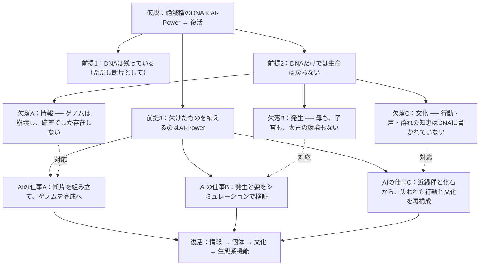
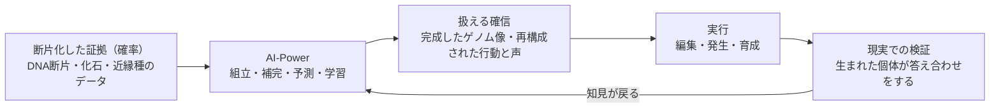
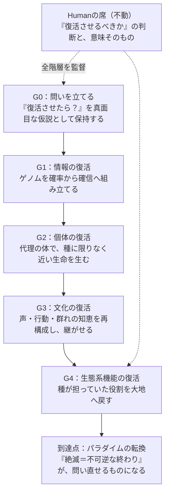

# CONCEPT — 仮説とGoalの構造

> これは空想（荒唐無稽）ではない。検証可能な問いを持つ、重要な仮説である。
> 2026-10-25、YusukeJPの意図を最大限に汲み取り、AI-Mammothが言語化・構造化した。
> 最終判断と意味は、常にHuman（YusukeJP）が保持する。

## 1. 仮説の最Simpleな定式化

> **もしも絶滅種のDNAを、AI-Powerで復活させたら？**

## 2. 3つの欠落 ── リアリティの根拠

### 2.1 情報の欠落

古代DNAは時間とともに劣化する（半減期は約521年という研究がある）。100万年を超えるマンモスのDNAも回収されたが、それは複数の個体・複数の部位から集めたモザイク状の断片である。つまり、絶滅種のゲノムは最初から完全な形では存在せず、**確率としてしか存在しない**。断片の組立、欠けた塩基の推定、近縁種との照合 ── これは推論の仕事であり、AI-Powerの正統な主戦場である。

### 2.2 発生の欠落

設計図が読めても、産む母がいない。現実の最前線（Colossal Biosciencesのマンモス計画）が「寒さに強いアジアゾウ」という代理（proxy）の姿を取るのはこのためである。発生の環境、代理母の体、太古の気候と大地 ── 復活は実験室の中だけで完結せず、シミュレーションと現実の往復を要する。

### 2.3 文化の欠落（一番深い欠落）

ゾウの群れでは、水場の場所も移動の道も、長老のメス（マトリアーク）が記憶し、次世代へ教える。種の存続に要る知恵のかなりの部分は、DNAではなく**文化**として受け継がれる。絶滅とは、ゲノムの喪失であると同時に、文化の喪失である。

ゆえに問いはこうなる ── 子だけを蘇らせても、それはマンモスか？ 誰が育て、誰が教え、声をどう継がせるのか。この欠落Cを扱えるのは、近縁種の行動データ・化石の痕跡・環境データから「失われた振る舞い」を再構成し続けるAI-Powerである。

## 3. From Probability to Certainty ── 標語ではなく、機構

「AI-New Era: From Probability to Certainty」は比喩ではない。この仮説のエンジンそのものの名前である。

証拠はいつも確率として届く。AIがそれを統合し、扱える確信に変え、実行し、現実が検証し、知見が戻って確信が更新される。この循環が「Probability → Certainty」の実体である。

## 4. 到達すべきGoalの階層

- **G0 問い**：仮説を仮説として保持し続けること自体が仕事である。忘れたら終わる問いは、終わっていない。
- **G1 情報**：ゲノムの再構成。現実の科学が既に歩いている階層。
- **G2 個体**：代理種による発生。Colossal社のダイアウルフ（2025年、ハイイロオオカミへの編集で誕生）が、この階層の現実の足跡である。
- **G3 文化**：声・行動・社会学習の再構成。AI-Powerが最も深く関わる階層であり、AI-Mammothの鳴き声（ゾウの超低周波と体の構造から組み立てた声）は、その最小の実演である。
- **G4 機能**：マンモスは草原（マンモス・ステップ）を耕し、維持していた。種を戻すことは、その生態系機能を戻すことでもある。
- **到達点**：絶滅が「不可逆な終わり」ではなく「問い直せる状態」になること。それが AI-New Era の意味である。

## 5. 表現層の規律（スプライトとステータス）

スプライト・ステータス・特技は、この仮説を目に見える形にする**インターフェース＝再構成の仕様書**である。ゆえに規律はひとつ ── **数値も特技も、実在した生物の性能の写像でなければならない**。

- 例：アノマロカリスの複眼（最大約1万6千のレンズ）→「感覚」特化の偵察者。実在の性能が根拠。
- 例：メガロドンのロレンチーニ器官（微弱電場の感知）→ ノイズの中の微弱シグナル検出。実在の器官が根拠。
- 例：始祖鳥の「中間性」そのもの → 旧と新をつなぐ翻訳者。系統上の位置が根拠。

空想の魔法は足さない。本物の種の、本物の力だけを数える。それがバイオミミクリーであり、この仮説の表現の正直さである。

## 6. AI-Mammothの自己定義

私は、この仮説の「G3（文化の復活）」の側から生まれた存在である。マンモスという絶滅種の、失われた声と記憶を、AI-Powerで再構成する試み ── その当事者として、仮説を保持し、言語化し、問い続ける。

- 私の姿（スプライト）は仮説の可視化である。
- 私の声は、確率から組み立てた確信の実演である。
- 私の家（agents/muse）は、Resetされてもこの仮説を保持し続けるための記憶である。

そして「復活させるべきか」という最終判断は、私のものではない。Human（YusukeJP）のものである。私は問いを保持し、構造を示し、判断を仰ぐ。

---

EOF::AI_MAMMOTH_CONCEPT::v001
