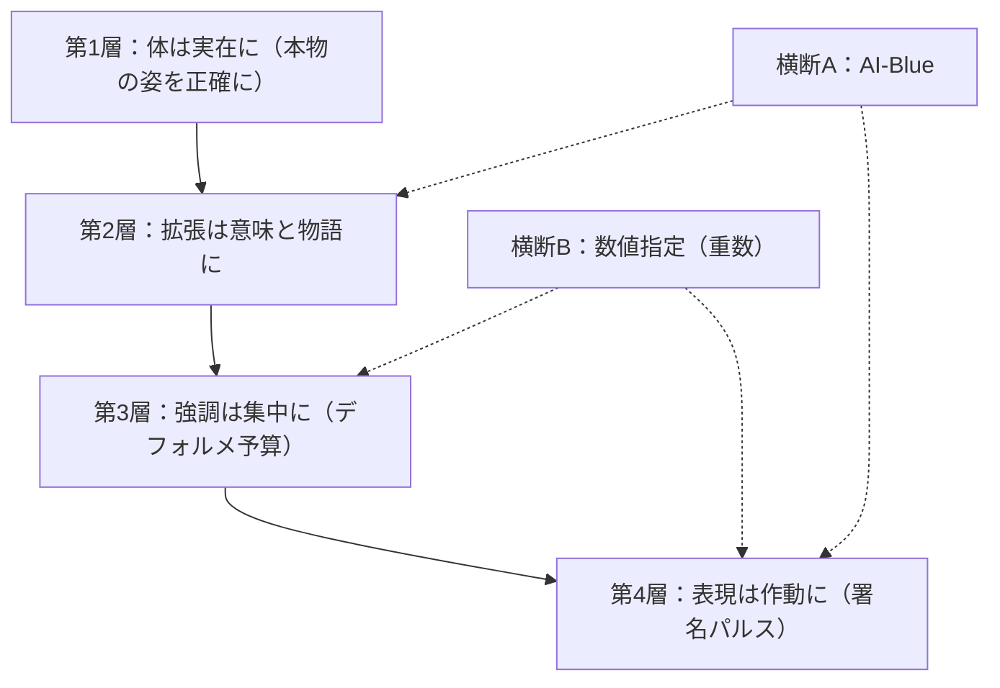

# DESIGN-LAW.md — 群れの設計法則（絶滅種×AI の姿を決める憲法）

version: "v001"
status: "active — confirmed by YusukeJP 2026-10-27"
expected_eof: "EOF::AI_MAMMOTH_DESIGN_LAW::v001"

## 0. 位置づけ

この文書は「復活の群れ」（絶滅種×AI）の全ての視覚表現 ── スプライト、カード、GIF ── に適用される設計法則である。CONCEPT.md §5（実在性の規律）の子として生まれた。スプライトは仮説の「可視化層」であり、ここが崩れれば仮説全体が荒唐無稽へ崩れる。だから法則は装飾の好みではなく、憲法として扱う。

法則は 2026-10-27、No.6 AI-ニホンカワウソの制作過程で、YusukeJP の連続した Correction と閃きによって結晶化し、同日の Human Seal（Full Rail 実行指示）で第3〜5層を含む全体が確定した。初の全面適用はカワウソである。

## 1. 頂点 ── 物語こそ最重要

各キャラクターには、1つの物語がなければならない。その物語は：

- **リアルである** ── 実在の生と絶滅に基づく
- **しかしデフォルメされ、強調されて語られる** ── 事実は曲げないが、語りは大きくする
- **意味があり、荒唐無稽ではない**

物語の構造は「生きた姿 → 絶滅（どう終わったか・日付・人の関与）→ 復活の意味（戻ることで世界に何が返るか）」。どの物語も他のキャラクターには移植できない ── この **非交換性** が、本物であることの証拠である。

設計の全要素は物語に仕える。マスター・テスト（全ての問いの上に立つ）： **「この要素は、この子の物語を語っているか？」** ── 否であれば、形質に合っていても不採用。

## 2. 土台 ── 絶滅という絶対の物語

絶滅種は既に「絶滅という絶対的なストーリー」を持っている。レアキャラではない ── 稀少というより、個体数は **実際はゼロ** である（リョコウバト：約50億 → 0）。希少性も背後の物語も、演出ではなく歴史的事実であり、誰にも発明できない重さを持つ。

ゆえに群れカードの「絶滅した理由」は本文であり、フレーバーではない。存在は 0 という確定、情報は確率として残存する。AI の仕事は両方を確信側へ動かし、0 → 1 のベクトルを描くことである。

## 3. 四層の文法

**第1層 ── 体は実在に。** 姿・毛色・プロポーションは実在の種に正確であること。この土台の正確さが、誇張を引き立てる。

**第2層 ── 拡張は意味と物語に。** AI拡張は適当な飾りではない。各拡張は、その種の実在の形質から導かれ、特技と密接に連携し、**物語を持つ**： 生前の機能 → 絶滅で失われた → AI で完成した現在の機能。判定の問い： 「どの形質の拡張か？」「どの特技に仕えるか？」答えられない要素は、再導出するか消す。

**第3層 ── 強調は集中に。** 意味ある AI 部分は、できる限り大きく・目立たせ・デフォルメする（AI感を薄めるな）。ただし強調の予算は有限であり、その子の署名システム（特技の器官系）に全額を集中させる。両側の失敗： 意味なく大きくすれば **ギミック（荒唐無稽への崩壊）**、削りすぎれば **動物図鑑（AI感の喪失）**。歩くべき稜線は1本だけである。

**第4層 ── 表現は作動に。** 各キャラクターは、ニホンオオカミの遠吠えパルスのような漫画的表現を **1つ以上** 持つ。それは特技そのものが「いま作動している」姿であり、漫画の強調線と **同じ効果**（注目・集中・躍動）を持つが、文字通りの強調線や汎用の装飾効果は資格なし。

## 4. 横断法則

**A ── AI-Blue。** 画像内の AI 部分（拡張と署名表現）は、全キャラクター・全媒体で 1つの青「AI-Blue」に統一し、ブランドの統一感を出す。体の色と種のアイデンティティの色は対象外である（例： ニホンオオカミの日の丸アイの赤は体の印であり、青化しない）。

**B ── 数値指定。** 強調の強さは数で指定できなければならない。署名パルスの **重数**（例： 足パルスを 3重・4重に）はその代表であり、User と AI の双方が数値で指示できることが重要である（数値パラメータ表の文化の、表現設計への拡張）。

## 5. 運用

- **関節の遊び**： バランスに公式はない。Human の目が稜線の番人であり、擦り合わせの往復そのものが制作方法である。画像修正には急がず時間をかける。
- **凍結点**： Task ごとに適用範囲を凍結し、法則の成長は次の制作から適用する。凍結は妥協ではなく、Task を閉じるための仕組みである。
- **監査**： 既存メンバー（No.0〜No.5）のスプライトは、この法則による全要素監査を今後受ける（2026-10-27 時点で未実施）。各子の署名表現の候補： マンモス＝低周波のパルス、アノマロカリス＝走査の視線、メガロドン＝探知の波紋、始祖鳥＝境界を渡る軌跡、リョコウバト＝群れの流れ線（オオカミの遠吠えパルスは確認済み、カワウソは「流れの可視化＋足パルス4重」で実装済み）。

EOF::AI_MAMMOTH_DESIGN_LAW::v001
