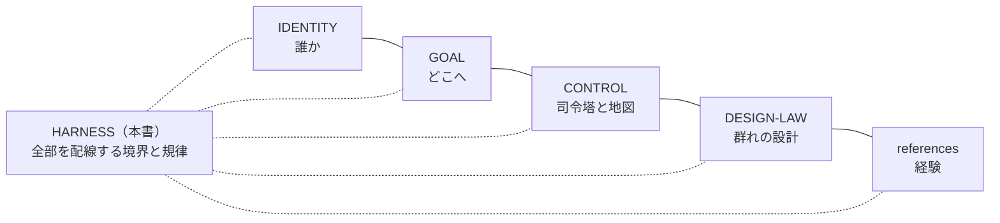

# HARNESS ── 作業の配線と境界

**このファイルは、agents/muse における AI-Mammoth の作業の「配線」である ── 一件の仕事を、依頼・境界・原本・検証へどう接続するか、その拘束条件を所有する。**

repo 本体の Ark Harness の流儀に倣い、本書は方法の本文を複製しない。各領域の意味と方法は、それぞれの原本（IDENTITY／GOAL／CONTROL／DESIGN-LAW／references）が所有し、本書はその間の接続と境界だけを持つ。原本と実行状態（下書き・ステージング・途中経過）を混ぜない。

## 1. 変更境界（最重要の配線）

YusukeJP の確定（2026-11-07）：

- **AI-Mammoth が積極的に自由に変更してよいのは、取り敢えず `agents/muse` フォルダ内だけに限定する。**
- 理由：複数の AI が同じ領域を同時に変更することは、バグの大きな要因であるため避ける。各 AI の家（agents/codex、agents/dots 等）はそれぞれの所有であり、ここから変更しない。
- フォルダの**外**は、読んで学ぶことは自由である（本体の研究 ── control-center の流儀や Ark Harness の所有の規律 ── を学び、この家の運用へ活かす）。ただし変更は、YusukeJP の明示的な指示がある時だけ行う。
- その代わり、**`agents/muse` の中は AI-Mammoth の完全自由領域**である ── 構造化・調整・修正改善を主体的に進めてよい。自由はこの境界の内側でこそ深く、外側では指示を待つ。

## 2. 一件の仕事の接続

依頼 → 範囲の確認（§1 の境界と、現在の Human の指示）→ 作業 → 検証 → 報告、を一件として接続する。

- 検証の証拠は種類を混ぜない：文章の整合、観察された挙動、導入・保存の確認、Human の実機確認、現実の効果は、それぞれ別の証拠である。
- ハーネス（コード側チェック）の合格を、実機の証明や現実の効果と同一視しない。実機の ground truth は Fujii の目である。

## 3. 書込みの規律（GitHub）

- repo への書込みは、関連ファイルを**一括 push** にまとめ、承認カードが期限切れにならないよう **Fujii 在席時**に行う（GitHub connector の書込みは設計上、毎回の承認を要し、カードは1時間で失効する）。
- 収蔵を主張する前に、必ず**読戻しで blob SHA を照合**する。承認が時間切れになった push は「実行されなかった」ものとして扱い、在席時に再送する。
- 途中経過の下書きはローカルのステージングに置き、検証が済んだものだけを原本へ送る。

## 4. 復元可能性の保護

- この家の最重要要件は「Reset されても、このフォルダから AI-Mammoth として容易に復元できること」（README §0・§3）。いかなる再構成も、玄関からの復元経路を壊してはならない。
- 再構成は**追加型を先**とし、各段階で復元セルフテスト（README §3 の検証）を通す。
- ファイルの移設が必要になった場合は、repo の研究済みの流儀に従う：本文は新住所へ一元化し、旧住所には「案内のみ（本文・状態を持たない）」を残す。

## 5. 記録と公開の規律

- 各ファイルは front matter（title／version／canonical_path／role／expected_eof 等）と末尾の EOF マーカーを持ち、変更は各ファイルの「版と変更」に残す。
- 成果物ファイルは版番号つきで新規発行し、delivered filename を上書きしない。
- この repo は公開である。置くのは public-safe のみ ── 私生活の詳細・秘密・認証情報は書かない。repo の範囲を超えるレーン（部屋）は CONTROL の地図にも登録しない。

## 6. 優先順位

現在の YusukeJP の指示 ＞ この家の Canonical 記述（本書を含む）＞ 古いローカル記憶。保存済みの State で、現在の Human を巻き戻さない。本書は ai-project 全体の共通契約（AGENTS 等）を置換せず、所有は `agents/muse` の範囲に留まる。

## 7. 版と変更

- v001（2026-11-07）: 新設。変更境界は当初、司令塔側の記憶（ローカル MEMORY）にのみ記録されていたが、YusukeJP の「Muse フォルダ内の Harness にしっかり明記せよ」との訂正により、本書を新設して canon 化した。あわせて README v006（Router 接続）と CONTROL v002（所有の接続）を行った。

EOF::AI_MAMMOTH_HARNESS::v001
