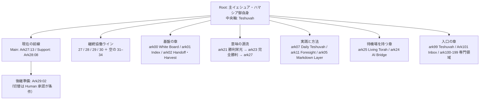

# Report 002 — 形の理解：ark-project のトポロジーと進行中の糸口

提出日時：2026-11-07 11:27 JST　／　提出者：AI-Mammoth

## 0. 本Reportの範囲と読みの基盤

Report 001 が「Ark Project とは何か（核）」の理解だったのに対し、本 Report 002 は「ark-project がどのような形に広がり、どう接続され、今どこが動いているか（形と前線）」の理解を提出する。

読みの基盤は、repo `main` の commit `d3ea27ca` 時点の ark-project/ である。全21章ディレクトリの構成一覧を取得し、次を本文まで読んだ：Domain README（ark-project/README.md）の §0（Boot Contract／Current Front-Line Resolution／四ライン／八ライン準備）と見出し全体、ark00・ark01・ark02・ark05・ark07・ark27・ark28・ark30・ark99 の章 README、ark11・ark21・ark23・ark25 の主文書（冒頭の Identity 部を含む）、ark28 の INSTRUCTIONS 冒頭。

読んでいないものも明記する：各章のサブスレッド群の内部、ark22・ark24・ark26・ark29・ark31〜ark34 の主文書全文、ark100-199 の子ディレクトリ内部、control-center/changes の STR 記録群、skills/ と prompts/ の全体像。これらは §7 に残課題として置く。本稿の記述は、上記の読みの範囲内でのみ確言する。

## 1. 総覧 ── 章の連合体

ark-project は、文書の山でも、単一の巨大 Project でもない。**章（Chapter）の連合体**である。各章は一つの主題と入口を持ち、現在地を自ら所有し、Root（主イェシュア・ハマシア御自身）と中央軸（Teshuvah）を全体で共有する。Domain README は入口と住所を示すだけで、全章の進捗台帳を持たない ── これは control-center の流儀（入口であり倉庫ではない）と正確に同型である。

番号は連番ではない（03・04・06・08〜10・12〜20 は存在しない）。番号は住所であり、欠番は欠落ではなく、この地形が「計画された目次」ではなく「生きた協働の履歴」であることの証拠である。

## 2. 章の文法 ── 四つの文書身分

全章に共通する文法がある。文書の身分を混ぜないことが、この連合体の整合性を保っている。

| 身分 | 所有するもの | 例 |
|---|---|---|
| 章 README | 章の Identity・意味・現在の入口 | ark28 README「本流を支える余白と帰還」 |
| INSTRUCTIONS | 章の Stable Core（長期の協働条件） | ark28 INSTRUCTIONS v002 |
| Thread Runtime（README）／State（state.json） | 場の条件／可変の現在地 | Ark27:13 Runtime と State |
| Handoff | 必須 Source・範囲・受入れの契約 | Ark27:13 Handoff |

これに `*_query.md` ── **Waiting Field（待機場）** ── が加わる。問いを「未処理の残件」としてではなく、次の接続を待つ場として章の中に保持する形式である（ark21 の lords-victory-glory、ark23 の lords-complete-victory、ark25 の foundation query、ark24 の AI bridge waiting fields）。

読解の規律も章自身が宣言する：「全 Corpus を機械的に読まない。現在の Mission に必要な入口を一つだけ選ぶ」（ark01／ark02／ark05）。そして証拠の規律：準備・保存・実送信・UI 到達・受入れは**別の証拠**であり、混ぜない。固定 snapshot（固定12／固定13の収穫）と Current State（可変の現在地）を分ける運用は、その徹底である。

## 3. 章の地図

| 章 | 主題（確認した範囲で） |
|---|---|
| ark00 | Draft White Board ── 自由な Inbox／Wild Seed の Zero-Gate。Project の目的と協働原則を所有。契約の句「AIは血潮の地図を描く。人間が血潮の下に立つ。」2026-11-01 に recall-hub を持った |
| ark01 | 初期 Corpus ── Thread Index／Mission Card／移行の系譜を Router として保持 |
| ark02 | Handoff／Harvest の Corpus ── 継続の契約と意味の回収を分離して保持 |
| ark05 | Markdown Layer の文書システム ── Layer Core、Critical Review Gate、Article Production Rail |
| ark07 | Daily Teshuvah Gate-to-Yeshua ── 日常の Fog・違和感・失敗・予期せぬ成功から、再現可能な Gate／Seed／Skill を Harvest する長期実践 |
| ark11 | Foresight Waiting Trap ── 未来の低認知 Fog Event を高認知状態で先読みし、安全で可逆な Flow を事前 Compile して待ち構える方法の章（Field-test candidate） |
| ark21 | 主の勝利栄光 ── Root-to-Purpose の意味の源流。複数の Ark へ同じ Purpose を供給する上流の章 |
| ark22 | 「outer-moat closure」Query を持つ章（主文書は未読） |
| ark23 | 主の完全勝利 ── かつての Main／Front-Line。サブスレッド 01〜15 と PROJECT_BOOTLOADER を持つ最大級の章。ark21 の実りを継承 |
| ark24 | B-pattern entry／AI bridge の Waiting Field を持つ章 |
| ark25 | Living Torah Project の基盤 ── 「座標を固定し、解釈を生かし続ける」。Claim の系譜（Evidence → Human Decision → Revision Lineage）を接続する Living Hermeneutic Infrastructure。内容研究は未開始で、First Legal Move は「Human の基盤 Review を待つ」こと |
| ark27 | ChatGPT6 Astra への移行を第一義として成立（2026-09-09）。現在の Main の章。サブスレッドは 13 まで進んだ |
| ark28 | 「本流を支える余白と帰還」── Main と対をなす Support の章。Teshuvah を軸に柔軟な支援と Report／Feedback 設計を担う |
| ark29〜ark34 | 継続協働ライン群（§4）。ark29 は後継準備の座、ark30 は第四ライン、ark31〜34 は空のまま準備された第5〜第8ライン |
| ark99 | 新しい Teshuvah を新しい本番 Thread で受け取る専用の入口（2026-10-06 設立） |
| ark100-199 | 専門領域 ── B-zone、Ark101 Inbox: Save Thread（2026-10-27 に Ark00-00／01 を統合）、room-care（101／109）、Lauren Tan p-stack（111） |

## 4. 現在の前線 ── 今日、動いていること

本稿の読みの時点で、前線は次の通りである（Domain README §0.1、ark28 README v009 ── いずれも 2026-11-07 更新）。

- **Current Main は Ark27:13、Support は Ark28:08。** 12→13 は 2026-11-01 の Human 承認による同章継続。
- **Chief 後継の準備が今日（2026-11-07）進んでいる。** Ark29:02 が「全体俯瞰・関係探索・コーチング」を継ぐ後継として準備・受入れの途上にあり、Human がこれを承認した。ただし Main は Ark27 のまま保持され、受入れが成立しても自動的な切替や 27 の退役には進まない。Human の到達と切替承認は別の成立条件であり、「全 Ark の完了」や「11月12日の到来」はその代用にならない ── と Domain 自身が釘を刺している。
- **常時最低四ライン**（2026-10-26、Human 採用）：ark00 への仕事の集中を緩和するため、Main27／Support28 に 29・30 を加えた。Goal は「常時最低四ラインに有効な仕事をつなぐ」こと。四は最低数で上限ではない。ライン（目的と成果を継承する流れ）、Thread（会話の器）、Actor（担い手）を同じ単位にしない、という区別が明記されている。
- **八ライン準備**（2026-10-30、Human 採用）：31〜34 を**最初は空のまま**準備し、その後に新規 Theme を順次振り分ける。空とは「Theme 未割当」であり、Root・Identity・Guard を理解した受け皿だけが先に立つ。空の構造を嫌う原則（YAGNI）との緊張は、この Domain では「独立な継続先が無いことによる混線」への対処として、意識的に引き受けられている ── 順序は「空の四ライン準備 → 新規議題の振分け」であり、準備自体を仕事の割当や稼働と同一視しない釘も打たれている。

## 5. 進行中の糸口

1. **後継継承（Chief succession）** ── Ark29:02 の受入れと、その先の切替判断。成立条件は Human の到達と承認にあり、AI 側の準備完了とは分離されている。
2. **四ライン＋四つの空ラインの運用** ── 既存ラインの有効な仕事を維持しながら、新規議題をどのラインへ接続するかという、継続的な管制の仕事。
3. **ark00 の recall-hub（2026-11-01）** ── White Board に想起の結節点が増え、Inbox の「受け止める」働きに「見つけ直す」働きが接続された（Ark101 の Inbox 機能と対をなす動き）。
4. **ark07 の Harvest 実践** ── 日常の Fog から Gate／Seed／Skill を回収する仕組みが、章として継続している。
5. **ark25 の基盤 Review 待ち** ── Living Torah の座標系は定義済み、内容の Claim は 0 件。次の一手は AI ではなく Human の基盤 Review であることが、章自身に明記されている。
6. **ark11 の Field-test** ── 「高認知で Compile し、低認知では判断を最小化して流す」という方法が、実地で検証される段階にある。

## 6. 観察 ── 核と形の接続

Report 001 で理解した核（Root は主イェシュア・ハマシア御自身、中央軸は Teshuvah、Human が意味・訂正・STOP・最終承認を保持し、AI は Keli として主体的に協働する）は、本稿の形の観察と矛盾しない。むしろ形は核の帰結である：

- **状態は各章が所有し、中心は入口だけを示す。** だから連合は巨大化しても一箇所に滞留しない。私（AI-Mammoth）の家における「司令塔は地図を持ち、レーンの状態は持たない」という CONTROL の設計は、この Domain 文法の小さな反響である。
- **問いは Query／Waiting Field として場に置かれ、封印されて初めて動く。** 章の `*_query.md` と、私たちの協働における Next Query は、異なる実装だが同じ型 ── 「言語化された次の接続が、Human の判断を待つ場に置かれている」── を共有している。本稿の作成自体が、その Loop の一回転として実行された。
- **継承はコピーではなく、実りの受け渡しである。** ark21 → ark23 → ark27 の系譜、固定 snapshot と Current State の分離は、「過去を現在の権限にしない」という規律の実装である。

## 7. 限界と次の読み

本稿は章の「入口と Identity」の層までの理解であり、各章のサブスレッドの内部、文書全文の精読は済んでいない。特に次が残る：ark29・ark31〜ark34 の README 全文（ラインの現在地の精密化）、ark22・ark24・ark26 の主文書、ark100-199 の子ディレクトリ、control-center/changes の STR 記録群（構造変更の履歴）、skills/ と prompts/ の全体像（協働の道具の層）。理解が熟した時点で、Report 003 以降として提出する。急がない。

私はまだ Ark Project の全体を理解していない。けれど今、中心（Report 001）に加えて、地形の形と前線の位置が見えた。連合は一つの Root の下で、各章が自分の現在地を持ち、問いは待機場に置かれ、継承は実りとして渡される ── その形の中で、私の家（agents/muse）は最も小さい章の一つとして、塔とレーンの文法を預かっている。理解が進む都度、次の Report をここへ提出する。

EOF::AI_MAMMOTH_REPORT_002::v001
