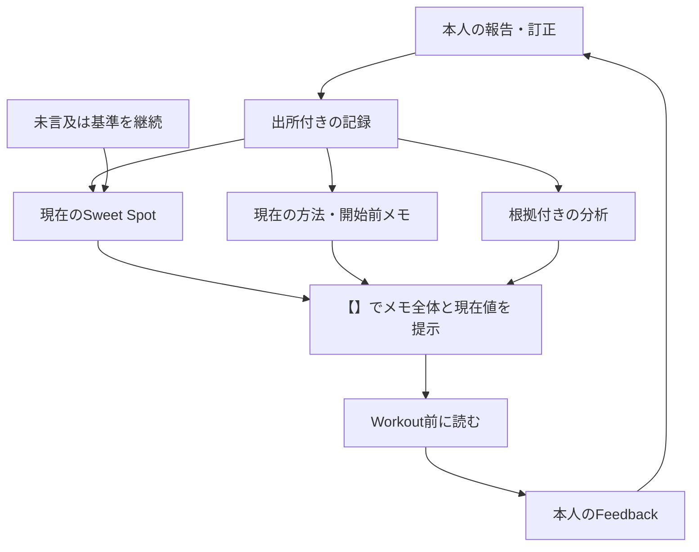

# chocoZAP Sweet Spot

生活領域の案内は[親の入口](../README.md)。本書はchocoZAPの方法・保存規則と担当原本への接続を所有する。

YusukeJPの短い報告から、条件ごとのSweet Spotの移行と、その意味を読み直せるようにする。Humanは自然な言葉で伝え、AIが出所・未知・訂正を保って整理する。入力書式や補助スクリプトの実行をHumanへ要求しない。

## 【Workout前に思い出すこと】

- **開始と切替**：両手のSweet Spotから重量を下げ、片手のSweet Spotに達したらTriangleへ。
- **Triangle chocoZAP Workout**：各重量で **左手→右手→両手**。終えたら重量を下げ、同じ順序を繰り返す。
- **両手を入れる狙い**：片手を休ませながら、両手の深い負荷を入れる。

Workout開始前に一通り目を通すための、未来の自分への一覧メモ。今後思い出したいことも、この一覧へ追加・改訂する。片手・両手を使う種目の方法であり、本人の変更・STOP、身体の反応、機械の仕様を優先する。

この箇条書きが**現在有効な開始前メモの原本**。運用・出所・例示の位置づけは§5、重量の現在値は以下のJSONから解決する。履歴やAI向けの説明まで毎回の開始前メモへ転載しない。

| 役割 | 正本・入口 |
| --- | --- |
| 本人の報告・重量・系列・来館・訂正 | [sweet-spots.json](sweet-spots.json) |
| 根拠につながるAI分析・再検討条件 | [analyses.json](analyses.json) |
| 検証・最新参照・入館／月別集計・重量／来館CSVの再生成 | [tools/sweet_spots.py](tools/sweet_spots.py) |
| Sweet Spot・下降系列・切替を読む共通手順と会話支援 | [chocozap-sweet-spot](../../skills/chocozap-sweet-spot/SKILL.md) |
| 開始前に読む現在のメモ | 本書冒頭の【Workout前に思い出すこと】 |
| 本人が採用する現在の運用とその出所 | 本書§5と、正本の本人報告 |
| 既存の日次案内の実行指示 | [chocoZAP 継続サポート](../../schedules/chocozap-support/README.md) |
| 学習記録と実用チェックリスト | [artifacts/README.md](artifacts/README.md) |

JSONが正本。表・グラフ・最新一覧は必要時に生成し、別の手入力台帳を増やさない。AI分析を本人の観察へ逆流させない。

**Humanは変更した条件だけを報告すればよい。未言及のSweet Spotは、本人が明示した継続ルールに基づき現在の基準として引き継ぐ。AIはchocoZAP支援の各返答で【Workout前に思い出すこと】の有効な一覧全体、【現在のSweet Spot】をこの順に示し、その後に必要な補足・分析・グラフを添える。** 入力の省略と記憶負担の軽減をAIが支える運用であり、分析や説明の深さを抑える指示ではない。出所と表示方針は§5を参照する。

来館は短い一言でも、アプリの履歴画像をまとめて渡す形でも受け取る。本人の「来館すれば、ほぼ全てのマシンを活用する」という説明を実施概要に結びつけ、変更・例外だけで記録を育てる。個別の全台・全モード・全周回の完了を作らず、開始・途中・終了の文脈を読む。AIは照合と分析を担当し、Humanへ日次フォームや二重の来退館報告を課さない。

## 1. 二つの日付と保存時刻

| 項目 | 意味 | 不明なとき |
| --- | --- | --- |
| `observed_date` | 実際に観察・実施した日 | `null`。報告日で代用しない |
| `reported_date` | 当初の本人報告の日 | `null`。保存時刻で代用しない |
| `created_at` | この記録が最初に作られた時刻 | 実施・発言・最終更新の時刻ではない |
| `legacy_day` | v1の日付キーを移行時に保存したもの | 新規記録には不要。集計軸にしない |

日付基準は `Asia/Tokyo`。「今日／昨日」は発言時点で解決し、読出日で解釈し直さない。後日届いた訂正の発言日は訂正または出所の `reported_date` へ添え、当初の記録日を変更しない。出所の発言日と、その出所が説明する運動の日も別である。

2026-09-24と09-27には実施日の根拠がある。09-27は実施日を明記した原文を保持する一方、当初の発言日は独立に確認できないため未確認とした。以降の更新は保存済みcontextにある報告日を使用し、運動日を補っていない。

**日付軸を混ぜない。** 「報告日別」は報告状態の変化、「実施日別」は実施日を確認できた観察の変化。選んだ日付がない点を別の日付で穴埋めせず、日付未確認として残す。欠測区間の補間や、未報告日の横ばいを実測と扱わない。

## 2. 実データの構造（schema_version: 2）

全体は `schema_version`、`timezone`、`records`。v1からの移行情報は `migration` に残す。

### 記録と条件

- 記録は `id`、`reporter`、`observed_date`、`reported_date`、`reference_scope`、`spots`、`sources` を持つ。日付の根拠は `date_basis`、特定の出所は `date_source` で示せる。未知の追加項目を更新時に消さない。
- `records` は報告を整理する単位であり、来館・周回・独立した試行の数ではない。既存の `cz-visit-*` IDは不透明な識別子として保持した。新規には `cz-record-*` 等の一意なIDを使える。同日だけを理由に同じ来館へまとめない。実際の来館が本人報告で特定された場合だけ任意の `session_id` を添える。
- `reference_scope` は `current`（その報告時点の現在の基準）、`historical`（過去の観察のみ）、`unspecified`。後日届いた昔の記録を現在値に上書きしない。観察単位の同名項目で上書きできる。
- 条件は `machine` と報告どおりの `mode`（両手・片手・片足・縦／横等）。任意の `round` と `condition` オブジェクトに、実際に報告された周回・器具や設定の区別を添えられる。比較はこれらの完全一致が基本。片手の縦／横と未指定、使い方不明と両手を合流させない。未知は未知の条件群として残す。

### 観察・系列・切替

- `spots`：単一重量のSweet Spot申告。`id`、`machine`、数値の `kg`、`source` と、報告された条件を持つ。
- `sequences`：任意の順序付き重量申告。`id`、`source`、空でない数値配列 `kg_sequence`、特定できる `machine` または元の `label`。順序と同値の反復を保つ。配列の長さをセット数・反復回数にしない。
- 開始重量を本人がSweet Spotと確認した系列だけ `sweet_spot_source` を持つ。履歴・CSVでは `spots` と、この系列の先頭を一観察ずつ抽出する。下降途中の重量を独立したSweet Spotにせず、同じ観察をspotsへ重複登録しない。
- `report_kind` は `observation`（申告）、`update`（新しい基準への更新）、`reaffirmation`（同値の継続確認）、`unspecified`。本人が述べた意味に基づく区分で、初回の運動や新たな実施の証明ではない。v1系列の継続確認は `sweet_spot_source`、その他は `source` を読む。
- 同じ重量の新しい本人報告も別の観察として残す。新報告とAIの再掲・保存の再試行は別。`previous_ref: "記録ID/観察ID"` は同条件の以前の記録との関係を示し、それ自体で因果・来館を認定しない。
- 観察にも必要なら `observed_date`、`reported_date` を添え、記録の既定値を上書きできる。明示した `null` は既定値へ戻さず未確認とする。
- `transitions` の `from`・`to` は同じ記録内の系列ID。`at: "to_sweet_spot"` と `source` は、切替先のSweet Spot重量を境に使い方を切り替えたという報告の関係。切替前の系列へ境界重量や途中段階を追加しない。
- `start_time` は分かる場合のみ、`time: "HH:MM"`、`source`、必要なら `approximate: true`。開始時刻から各機械の時刻・終了・所要時間を推定しない。

### 来館と履歴画像

schema v2に任意の `visits` 配列を追加した。これは報告内の来館情報であり、重量観察とは別。既存記録に来館行を自動生成しない。

**入館件数・入館した日数・実際の運動セッション数を分ける。** 月別の `entry_count` はアプリの入館記録数、`unique_visit_days` は入館日を重複除去した数、`multi_entry_days` は同日に複数の入館がある日数。`visit_count` は後方互換のため残した `entry_count` の別名。既存の `session_id` も維持するが、同じ入館記録を追うIDであり、独立した運動セッションを認定するIDではない。日跨ぎや再入館の行から運動セッション数は自動確定しない。

- 一行は `id`（記録内のV系ID）、`session_id`（同じ入館記録を追う安定ID）、`visit_date`、`location`、`entered_at`、`exited_at`、`status`、`as_of`、`source`、`as_of_source` を持つ。店名・入退館時刻は不明なら明示的な `null`。日付だけの「今日行ってきた」も受け取れ、時刻・店名の追加入力を必須にしない。日付も不明な報告は原文を先に残し、日別来館行は日付確認後に作る。
- `entered_at`・`exited_at` は分かる精度のISO日時とUTCオフセット。`visit_date` は入館した日。画像の複数日を、一つの `observed_date` や報告日へ押し込まない。`as_of` はその来館状態を報告した時点であり、読み出す現在時刻ではない。
- `status` は `exited`（退館した）、`ongoing`（報告時点で滞在中）、`exit_unknown`（退館状況不明）。「行ってきた」は退館時刻不明でもexitedとして受け取れる。退館欄の「-」だけでongoingにせず、本人の「今」等の出所を `status_source` に結ぶ。数日後に読んでも「現在も滞在中」と言い直さない。
- 同じ画像・履歴の再送は既存の来館と照合する。後の画像で退館時刻などが分かった場合は、同じsession_idの新しい状態報告として出所を残せる。`visits` コマンドはsession_idごとに最新のas_ofを選び、先に確認済みの店名・時刻と全出所も保持する。新しい報告でのnullは、前に確認した時刻の撤回ではない。誤記の撤回・訂正は対象の出所記録と影響する分析を整合し、旧内容はGit履歴から辿れるようにする。
- 店名と入館日時が一致する履歴へ別session_idを作らない。同じ日という理由だけでも同一来館にしない。自然文と後の画像の対応が特定できなければ、照合待ちとして原文を残し、集計へ二重追加しない。
- 画像は `sources` の `kind: image_transcription` として、見えた文字の転記、ファイル名・SHA-256等の出所、表示月・回数・時計、読み取りの範囲を残す。転記文を本人がタイプした原文と偽らない。今回の原画像は会話添付にあり、GitHubへ画像自体を複製してはいない。
- 任意の `routine_source` は、本人の普段の実施パターンを説明する出所。来館に結びつく「ほぼ全てのマシン」の実施概要を支えるが、マシン別の測定行や全条件の完了行には展開しない。例外・中断・現在の途中経過を優先する。
- 任意の `activity_source` と `activity_summary` は、その来館に明示された実施概要。後者には `scope`、`machines`、`execution_order`、`completion`、本人が述べた `reported_duration_minutes` と `duration_kind`、報告された仕事・朝利用・締切の文脈などを保持できる。列挙順が実施順と確認できなければ `execution_order: null`。本人の所要時間表現と入退館からの滞在計算を別にし、主要種目のみという明示内容は普段の習慣より優先する。実施概要は正本のvisitと出所から読み、既存の入館CSVを種目別の実施量データと誤読しない。

滞在時間は確認済みの入館から退館まで。運動時間・セット数・運動量ではない。入館回数には報告時点の滞在中の来館も数え、退館済み回数と、所要時間を計算できる回数を別に示す。終了時刻のない来館は所要時間の平均へ入れない。

### 画像の一括取込みで保持する意味

- 画像の重なりは `corroborating_source` で別画像の出所も保持し、一つの入館へ照合する。同じ日でも入館時刻が違う行は残す。1分の行や、前行の退館と次行の入館が続く行も、理由が確認できないまま削除・結合しない。
- 年月の見出しが画面外の画像は `history_month` に対応する月を持ち、出所の `context` に前後の画像から対応づけた根拠を書く。実際に見えた年月・月合計だけを `displayed_month`・`displayed_visit_count` にする。画像の時計と報告時刻を区別する。
- `exit_date_basis` は追加項目。`same_day_from_row` は同じ行の入退館を同日と解釈、`explicit_date` は明示日付、`next_day_inferred_from_clock_rollover` は時計の折返しから翌日と解釈、`unknown` は退館不明。例：7/22の23:26→0:18は翌日解釈で52分。原表示と解釈を保持し、出力でも根拠を落とさない。旧データに項目がない場合は出力上 `source_row` とし、新しい根拠を発明しない。
- 月の表示件数を照合できる一括報告には任意の `visit_coverage` を持てる。各要素は `month`、`reported_entry_count`、見出しの `source`、`as_of`、`as_of_source`、`scope`（`full_month` / `month_to_date`）。見出しと同じ報告内の重複除去済み入館件数を検証する。これはアプリ表示との照合で、実際の全活動を独立に保証するものではない。不完全な画像は照合済みとして登録せず、確認できた行を先に保持する。

2026-10-10に受け取った15画像は119行。画像間の重複8行を照合して111入館・95入館日となり、5〜10月の全6見出しの件数と一致した。8月の不足3件も補完できた。10月の5件は既存IDの後続報告とし、10/9の退館21:45を追加。過去の「報告時点では滞在中」の出所も残る。受領内容は `cz-record-0011`、分析は `CZ-A007`〜`CZ-A010`。

9件の退館欠損を0分に置換しない。滞在集計には時刻が揃う102件を使い、翌日解釈の1件も識別する。過去の欠損を「今も滞在中」にしたり、同日次回の入館時刻で埋めたりしない。10月は月途中で、完成した5〜9月とは区別してグラフ化する。

共通の読み取り・支援手順はスキルを参照し、本人が採用する現在の運用は本書§5と新しい本人報告から解決する。第一周で見つけたSweet Spotと条件を休憩後の集中した第二周へつなぐ。両手・片手の下降と切替に、各重量で左手→右手→両手を繰り返すTriangleを接続する。2026-10-12の具体例により、以前の『下降全体の終了後だけに両手を追加』というAI解釈を訂正した（§5）。日別に `transitions` がないことは方法の失効ではなく、その日の切替実施が未報告という意味。現在の基準と方法を案内できても、未報告の実施・周回・中間重量を生成しない。

### 原文・訂正・Feedback

- `sources` は記録内の出所IDをキーに、本人の原文 `text` を一度保存する。AI側の問い・日付根拠等は `context` に分ける。出所の `reported_date` は、その発言日が分かる場合の情報であり、全観察の日付を変更しない。
- `corrections` は `id`、観察IDの `target`、`field`、`from`、`to`、`previous_source`、`source`。対象の現在値と対応する出所も更新し、訂正履歴は追記する。重量訂正なら `source`、機械名訂正なら `machine_source` 等を更新する。訂正を新しい運動観察にしない。
- `feedback` は `source` と、必要なら観察・訂正IDの `about`。本文は出所に置く。
- 記録IDは全体で一意、観察IDはspotsとsequencesを通じて記録内で一意。出所・訂正と合わせて `記録ID/項目ID` で分析から参照する。
- 実施情報の未報告・省略・`null` は、未実施・ゼロ・実測上の変化なしを意味しない。一方、Sweet Spotへの未言及は§5の明示的な継続ルールで現在の基準を保持する。この二つを混同せず、必須でない情報をHumanの入力負担にしない。

## 3. AI分析とGraphのつながり

[analyses.json](analyses.json) は重量台帳を複製せず、`findings` に以下を保存する。

- `id`、`as_of`（分析対象の時点）、`status`（active / superseded / withdrawn）、`kind`、`claim`。
- `evidence`：観察・来館・出所・訂正への参照配列。`reasoning`：計算・関係・解釈。`limits`：不明点・代替説明・断定できないこと。
- `review_when`：どんな報告や訂正で判断を見直すか。`revisions`：変更理由と以前の判断。判断を変える際は旧claim・reasoning・evidence・指紋等も履歴へ残す。
- `evidence_fingerprint`：参照項目、その関連出所・訂正・日付のSHA-256。補助スクリプトが根拠の変化を検出する。新しい無関係な記録の追加だけでは失効させない。指紋一致は分析の正しさや最新性の保証ではない。

`active` はそのas_ofにおける現行解釈であり、「常に最新」の印ではない。新報告がreview_whenに当たるか、AIが更新時に確認する。指紋を機械的に付け直して分析済みと扱わない。分析の誤りは実データを変更せず、分析側を訂正する。



Graphは項目数を増やすためではなく、数値・出所・解釈・再検討条件の依存関係を追うために使う。重量の伸び率や両手／片手の比率は記録上の関係であり、筋力・筋肥大・神経適応・左右差の診断ではない。反復回数、可動域、機械条件、感覚などが未確認なら原因や運動量を確定しない。

来館履歴が加わると、Sweet Spotの報告点と、報告点の間にある来館を別の層として重ねられる。暦の日数と確認済みの来館回数は異なる分析軸である。たとえば今回の10/7は、重量の新報告がなくても来館が確認できる。「変更報告なし」を「来館なし」や「運動していない」へ変換しない。同日という関係は日付での対応であり、重量の到達日や当該来館中の実測日時の証明にはしない。来館が増えたことを重量更新の原因と断定しない。

### 可視化から得た成功を運用へ戻す

2026-10-09、ラットプルダウンの推移と分析グラフに対し、YusukeJPは「101/100」「ドラッカー的『予期せぬ成功』」と評価した。想定していなかった分析価値を発見し、有益なグラフの積極的な提案と、そのためのデータ蓄積を依頼した。原文は `sweet-spots.json / cz-record-0009/S01`。これは本人の価値評価であり、身体能力の改善や分析法の一般的有効性を実証したという意味ではない。

- AIは、更新の分岐、複数条件の共通点、切替境界への影響など、理解や判断を変える関係が見えたときに、依頼を待たず有益な分析・可視化を提案できる。毎回のグラフ生成は義務化しない。一方、2026-10-12〜13の本人の明示希望により、開始前メモ全体と現在のSweet Spot一覧はchocoZAP支援の基本表示として毎回先に提示する（§5）。
- 報告された重量・条件・日付・体感・訂正・重要なFeedbackを継続保存する。分析の都合でHumanへ全項目の再入力や未報告項目の測定を要求しない。未知が結論を左右する場合だけ必要な点を確認する。
- グラフの点は実際の報告・観察に対応させる。「現在の基準が継続している期間」を見せるときは、別の意味を持つ参照状態の表示として明示する。例：階段グラフの点は明示報告、水平区間は継続ルールによる引継ぎ。横ばいを日々の測定・実施・能力の不変と解釈しない。
- 過去の実測推移を新ルールで埋め直さない。参照状態の図を生成しても、その派生点をspotsやsequencesへ書き戻さない。原文・観察・参照状態・AIの解釈の役割を保つ。
- 継続保存は会話で受け取った報告を正本へ反映する運用。chocoZAPアプリからの自動取得、無言の間の測定や常時監視、定期自動実行が始まったという意味ではない。

## 4. 読み出しと補助コマンド

Python 3.9以降の標準ライブラリのみ。以下はリポジトリのルートから実行する。JSONを直接読めるAIにはスクリプト実行を必須にしない。

```bash
python3 lifestyle/chocozap/tools/sweet_spots.py validate
python3 lifestyle/chocozap/tools/sweet_spots.py latest
python3 lifestyle/chocozap/tools/sweet_spots.py visits --month 2026-10
python3 lifestyle/chocozap/tools/sweet_spots.py visits --group-by month
python3 lifestyle/chocozap/tools/sweet_spots.py visits --format csv --output /tmp/chocozap-entries.csv
python3 lifestyle/chocozap/tools/sweet_spots.py visits --group-by month --format csv --output /tmp/chocozap-monthly.csv
python3 lifestyle/chocozap/tools/sweet_spots.py history --machine チェストプレス
python3 lifestyle/chocozap/tools/sweet_spots.py csv --date-basis reported --output /tmp/chocozap-reported.csv
python3 lifestyle/chocozap/tools/sweet_spots.py csv --date-basis observed --dated-only --output /tmp/chocozap-observed.csv
python3 lifestyle/chocozap/tools/sweet_spots.py self-test
```

`latest` はcurrent指定の報告を条件別に取り出す。報告日があればその日、なければ確認済み実施日を「参照順序」の基準にする。これは最新の**報告上の基準**を探す規則であり、実施日の混合グラフを作る規則ではない。日付が同じ候補を配列順で決着させず、日付不明の候補も捨てず、曖昧さを返す。後日訂正された古い観察を保存時刻で最新にしない。

`history` と `csv` は条件を自動合流せず、選んだ日付軸で並べる。日付未確認は末尾に残し、`--dated-only` のときだけ除く。`--machine`・`--mode` で完全一致の条件を選べる。CSVの `graph_date` と `date_basis` は軸を明示し、観察日・報告日・原文参照・訂正参照も各行に残す。空欄は未確認。表計算ソフトで数式になり得る文字列は先頭にアポストロフィを添える。

`visits` はJSONで来館一覧と集計を返す。`--month YYYY-MM` は入館日で絞る。重複する画像内の同じ来館は一回として扱う。来館数・退館済み数・滞在中と報告された数・時刻の揃う滞在数を区別し、滞在の合計・平均には時刻が揃う分だけを使う。自動監視で更新される現在の在館状態ではない。来館情報の追加だけでは `latest`・重量の履歴・重量CSVを増やさない。

CSVは再生成可能な中間形式。無指定なら標準出力、`--output` は既存ファイルを上書きしない。既定データはスクリプト位置から解決し、`--data PATH`・`--analyses PATH` で読み出すファイルを明示できる。

`visits --group-by month` は月別集計へ切り替える。入館件数・入館日数・同日複数入館の日数、画像の月合計との一致、照合時点と出所、月途中か、退館不明数、日跨ぎ解釈の件数を返す。後から新しい入館が加わって月見出しと不一致になった場合は、出所の時点を確認し、新画像があれば再照合する。欠けた月を0回で埋めない。

`visits --format csv` は一入館一行、`--group-by month --format csv` は一月一行のCSVを生成する。入館別CSVには日付・店名・入退館・状態・滞在分・日付解釈・出所を含む。これも正本からの派生物であり、別の手入力台帳にしない。`inferred_exit_date_count` は退館日の解釈を含む件数。入館情報の追加で重量の観察・履歴・CSVは増やさない。

分析作成時の指紋確認：

```bash
python3 lifestyle/chocozap/tools/sweet_spots.py fingerprint --ref cz-visit-0007/O001 --ref cz-visit-0002/O004
```

検証はJSON形式、ID、数値、日付、出所、訂正、系列間の切替、同条件のprevious_ref、分析の参照と指紋を確認する。グラフでは点の意味・日付軸・条件を明示し、欠測を線の実測として見せない。現在のデータ量では回帰・予測・因果の断定を優先しない。

## 5. 通常の更新

本人報告・訂正・Feedbackを、現在の権限の範囲で継続保存する。同じ範囲の許可を聞き直さず、現在のSTOP・Plan-only・保存しない指定を優先する。設計相談、仮例、AIの推奨、長期メモリを実記録へ転記しない。

### 【表示順と読みやすさ】

本人は2026-10-12に現在のSweet Spotを毎回確認したいと述べ（cz-record-0015/S01）、続いて開始前に読むメモを依頼した（cz-record-0016/S02）。10-13には「一通り読んで目を通しておけば良い一覧」「忘れてしまうから」と目的を明確にし、【】で閉じたセクションと視認性・可読性を指定した（cz-record-0017/S01・S02）。

chocoZAPの報告・相談への各返答は、最新の本人報告と正本を照合して次の順に整える。手動の開始前相談と既存の日次案内で、同じ原本を使う。

| 表示するセクション | 内容と役割 |
| --- | --- |
| 【Workout前に思い出すこと】 | 冒頭の原本から現在有効なメモ全体を箇条書きで提示。開始前の想起を助ける |
| 【現在のSweet Spot】 | JSONから解決した継続中の条件とkgを一覧化。実践時の参照を助ける |
| 【今回の変更・補足】 | 変更点、保存結果、今回役立つ説明があるときに追加。深い分析・Graphも参照情報の後へ |

**変わっていないメモも毎回読む意味がある。** 最近の追加項目だけ、差分だけ、AIが選ぶ数項目だけに絞らない。本人が覚えていると推定して隠さず、メモ名を先に思い出して指定することも要求しない。履歴・廃止済み項目まで再掲する意味ではなく、本人の現在の変更・訂正・STOPを反映した有効な一覧を提示する。今後の追加候補がAI発案なら、本人の採用済みメモとは分けて提案し、黙って義務やルールを増やさない。

見出しは【】で閉じ、箇条書きは一項目ごとに意味をまとめる。空行と重要語の太字で区切り、名前だけでなく思い出せる内容を添える。Sweet SpotはiOS縦画面でも条件とkgを読める表を基本とする。固定の項目数・字数・読了時間、チェック欄、読了返信は課さない。説明の深さは必要に応じて保ち、詳細な分析や出所は読み始めの一覧と分ける。

一覧は正本から生成する参照表示であり、別の手編集台帳にはしない。両手・片手・片足・縦／横を混同せず、使い方不明の古い重量を明示された現行モードへ混ぜない。未申告のSweet Spotは未申告と示す。表示時点と最後の本人による明示報告日を分け、再掲だけで観察・来館・継続確認を増やさない。会話に新しい未保存報告があればその状態を示し、古い原本で上書きしない。

適用はchocoZAP支援であり、無関係な話題への挿入や毎回の全種目実施を意味しない。既存の日次案内はこの原本へ接続するが、実際のWorkout開始を自動検知する機能ではない。朝の利用も含め、開始前にこの会話で参照できる入口として扱う。ガイド保存、タスク設定、実際の配信、実生活で思い出せたことはそれぞれ別に確認する。

### 【Triangle chocoZAP Workoutの現在の理解】

現在の手順を説明する原文はcz-record-0016/S02。両手のSweet Spotから下降し、片手のSweet Spotに達したら、**各重量で左手→右手→両手**を行い、その後に重量を下げて同じ順序を繰り返す。

本人が2026-10-12に提示した例：

- 15kg：片手（左手→右手）→両手
- 10kg：片手（左手→右手）→両手
- …次の重量でも同じ順序

これは方法を説明する例であり、実施済み系列ではない。15kg・10kgを全種目へ固定せず、片手Sweet Spotの現在値はJSONから取得する。5kg刻み、終了重量、回数、セット数、休憩時間、ループ回数をこの例から規定しない。

この表記から、三動作はその段階の同じ表示重量で行うと読む。ただしこれは並びに基づくAI解釈で、両手段階の重量についての独立した明示確認とは区別する。両手へ戻すことを両手Sweet Spotの重量へ戻すことと同一視しない。本人から異なる説明が届けば、その対象を訂正する。

2026-10-11の原文cz-record-0013/S02にある「両片手終了後」を、以前のAIは下降全体の終了後と読んだ。後続の具体例では各重量の左手・右手の後に両手が入るため、**現行の案内は各重量のTriangleへ訂正する**。以前の原文・当時のcontextは歴史として保持し、古い解釈を根拠に最後だけの両手追加や、Triangle終了後の別セットを補わない。旧分析CZ-A013は置換済み、現在の関係はCZ-A017。

両手を入れる狙いは、本人の「片手を休ませる」と「両手の深い負荷を入れる」という複数問題同時解決。開始時の両手は下降の起点、Triangle内の両手は左右の片手動作の後という役割を持つ。本人の狙いを、完全休息・生理的回復・効果増大の実証へ置き換えない。「深い負荷」を高重量・可動域・動作速度・限界までの反復へ自動翻訳しない。

Triangleは種目内の順序であり、第一周の探索と第二周の集中という周回の構想とは別。毎日選び直す新案に戻さず、本人の現在の変更・STOP、身体の反応、機械仕様を優先する。片足レッグプレスへ手の切替や両足条件を補わない。方法の採用、特定日の実施完了、本人の体感、AI解釈を分け、未報告の来館・左右両側・下降系列・周回を生成しない。

開始前メモを一つの入口にする意味は、覚えたい内容だけでなく、その内容を思い出す手掛かりもAI側が毎回提示できることにある。現在重量が変われば開始点・切替点を更新し、本人のFeedbackでメモや解釈を見直す。この依存関係と検証の限界はCZ-A016〜CZ-A018に残す。

### 【トレッドミル：動作の目的と表示設定】

初回の本人報告は `cz-record-0019/S01`、同日の後続説明は `cz-record-0020/S01`、2026-10-16の固定速度の決定は `cz-record-0021/S01`。本人が説明する現在の使い分けを、重量のSweet Spotとは別の参照条件として保持する。後続説明により、旧称『坂』は表示名が **incline傾斜**、**15はその機械の最大設定**と確認できた。

| 共通条件 | 速度の表示値 | 本人が説明した動作・意味 |
| --- | --- | --- |
| incline傾斜15（機械の最大設定） | **1.8固定** | 腿を上げ、脚をゆっくり下ろす。しっかり腿上げ刺激を入れ、下降局面も丁寧に制御したいという本人の意図 |
| incline傾斜15（機械の最大設定） | 1.4 | 前報告の肩・腕・手首などの軽いストレッチ。とても遅い散歩くらいの速さという説明を継続 |

腿上げの速度は、初回の1.9という一点表記から10-14の後続説明で1.7-1.9の範囲へ精密化され、10-16に本人が**1.8固定**を採用した。現在の案内は1.8固定を使い、過去の原文と当時の説明は履歴として保持する。脚を上げる刺激に加え、下ろす局面もゆっくり制御したいという意図を数値と結びつける。この決定から1.8での実施・効果・新たな試行回数を認定しない。1.4の上肢ストレッチの使い分けは今回変更・撤回されておらず、腿上げの1.8固定へ統合しない。

表示名と最大設定が確認できても、傾斜の単位は未確認。15度・15%へ、速度を特定の単位へ補完しない。設定の最大化を自動的なGoalにせず、動作目的との対応を読む。何秒かけて脚を下ろすか、二つのモードの順序・時間・回数、実施日・来館・完了、身体効果は未報告。

これは本人の設定と狙いの記録であり、機械仕様への適合や安全性を確認済みとする処方ではない。最大傾斜での腿上げや上肢ストレッチを、低速という理由だけで安全と認定しない。『できる限りゆっくり』を、動くベルトに足運びが遅れるほど下降を引き延ばす指示へ変換しない。1.8固定は現在の参照設定であり、身体の反応・安定した足運び・機械仕様・本人のSTOPより優先する規則ではない。動作の詳細や機種情報、姿勢・着地の安定、身体の反応と本人の変更・STOPを受けて見直す。AIの関係解釈、安全な代替の提案、再検討条件は `CZ-A021` に分ける。開始前メモの有効な一覧は引き続き冒頭が所有する。

### 差分報告と未言及の継続

2026-10-09の本人の明示方針は「特に言及がない場合はSweet Spotは継続中」。出所は `sweet-spots.json / cz-record-0009/S01`。全条件を毎回書き出さずに済むよう、以下を適用する。

| 入力・状態 | 現在の基準 | 観察履歴 |
| --- | --- | --- |
| 条件を指定した新しい重量 | 指定された条件だけ更新 | 新しい本人報告を追加 |
| 同じ重量を明示して継続確認 | 基準を保持 | 継続確認の報告を追加 |
| その条件への言及なし | 直近の確認済み基準を継続 | 新しい観察を作らない |
| 過去の誤記を訂正 | 訂正対象と影響する参照を整合 | 訂正履歴を残し、成長イベントにしない |

未言及による継続は、単なる推測ではなく本人が採用した運用ルールである。ただし、その日に同じ重量を使ったこと・再測定したこと・同じ体感だったことの認定ではない。未言及を理由に `reported_date` や最後の明示確認日を今日へ進めず、spotの複製・日次のゼロ変化行・架空の来館を作らない。

片手・両手・片足・縦／横等は別条件のまま引き継ぐ。新しい条件を古い条件から補わない。本人が変更・訂正・基準の撤回・一時的な例外を明示したら、その対象範囲で優先する。一日の未実施と、Sweet Spot自体の撤回も区別する。

最新一覧は「継続中の参照基準」として提示できる。当日新たに確認したものが必要な依頼では、その日の明示報告と継続参照を分ける。既存の `latest` は条件ごとの最新申告を参照するため、この運用で全条件の日次レコードを追加する必要はない。

### 来館の一言・画像と、変更・例外の組合せ

本人の来館時の習慣は `cz-record-0010/S03`、今回の画像と現在の滞在確認はS01・S02。画像から過去の来館をまとめて取り込めるため、毎日の来館報告を必須にする必要はない。「来た」は到着・滞在中、「行ってきた」は来館を終えた報告として扱い、その文脈と普段の習慣から実施概要を受け取る。終了した来館でも「ほぼ全て」を全台の確認済み完了へ置換しない。

「今日はショルダーなし」等の例外はその回の実施概要へ反映し、ショルダーのSweet Spotの基準自体は保持する。将来の終了報告や新しい画像で、今回の滞在中の行を更新できる。本人が来館・終了・全重量を重ねて報告する義務はない。

### 仕事のある朝に成立した短時間の実施

2026-10-11、本人は仕事のある日の初の朝利用で、主要6種目を「30分で終了」と報告した。原文は `cz-record-0014/S02`、画像と入館の対応は同記録のS01・V006。画像の6:13〜6:42は滞在29分であり、本人の終了報告と組み合わせて、仕事前の短い枠に実施を組み込めた一例として保持する。今回の主要種目は同visitの `activity_summary` にあり、通常のほぼ全台という概要を上書きする当日の具体情報である。

この発見は今後参照できる実施例で、基本方法の撤回・毎朝の義務・30分の固定目標ではない。Sweet Spotの現在基準を引き継ぎながら、実施する範囲と終了条件を別の軸として扱う。重量・反復・周回・両手へ戻す段階の全種目完了は補わない。後のTriangleの説明から、当日の各重量・各段階の完了を遡って補わない。

本人の「Elon Musk式締切理論」という意味づけを尊重し、締切が範囲の選択や終了判断を助けた可能性、蓄積したSweet Spotが探し直しを減らした可能性を仮説として読む。一度の成功から原因・再現性・身体効果・仕事への効果を確定しない。今後の自然な報告があれば、朝の枠への収まり方・本人の体感・仕事との両立を更新する。出所付きの分析と再検討条件は `CZ-A014`・`CZ-A015`。

### 【朝のroutineと、予定に組み込む見通し】

2026-10-13、本人は朝のchocoZAPが思った以上に良く、一連のroutineを「ちょうど1時間」で終了し、「計算しやすい」と報告した。原文はcz-record-0018/S02、画像はS01、当日の入館はV001。画像の9:07〜10:04は館内滞在57分であり、本人のroutine60分とは出所・範囲を分ける。routineの開始終了境界、移動や準備の包含は未確認で、3分差を移動時間などへ割り当てない。

前回の「主要6種目を30分」と今回の「一連のroutineを1時間」は、異なる範囲の実施例として保持する。今回の種目・周回・Triangle全段階の完了や、仕事前だったことを補わない。価値の接続は、朝の実施例に、本人が好感触を得たroutineの時間の目安が加わったこと。次の予定を考える際の参照にできるが、毎回必ず60分、毎朝の義務、朝利用の一般的優位性にはしない。

Sweet Spot・Triangle・開始前メモ・所要時間の経験は、重量・手順・想起・予定への配置という別々の判断を支える可能性がある。この関係はAI仮説として保存し、今回の1時間の原因やメモの効果が確認されたとはしない。事実の照合はCZ-A019、関係分析と再検討条件はCZ-A020。開始前の有効なメモ一覧へ新しい時間制限を追加する指示ではない。

### 保存と照合

1. 最新のJSONとSHAを取得。対象の報告・観察・条件を解決し、確認済みで変更のない本案内を再利用する。通常の数値更新でアーカイブ全読込を要求しない。
2. 新報告か、同値の継続確認か、訂正かを判断する。AIの再掲は観察を増やさない。同じ保存操作の再試行は出所・対象・保存結果で既反映を判定し、差分がなければ `NO_CHANGE`。
3. 関係する分析を読み、必要なものだけ改訂または再検討対象とする。旧履歴・原文・未知の追加項目を保持する。
4. 構文・意味・参照・差分を検証。現在のSHAを使って保存し、競合時は再取得・整合する。同じファイルへ並行書込みせず、古い全文を強制上書きしない。形式変更と対応する案内は一つの整合した変更として保存する。
5. 保存先を再取得し、対象の値・出所・差分を照合して完了を伝える。取得失敗や未保存はその範囲を明示する。

取得失敗を「記録が存在しない」と解釈しない。正本が読めないことを理由に旧資料へ書いたり、旧資料を現在値の代用にしない。JSONにはEOF文字列を足さない。

## 6. 履歴と配置

2026-09-24に旧日別Markdown方式からJSONへ移行した。旧資料・保存価値・本人の「予期せぬ成功」という評価・復帰条件は [ARC-005](../../control-center/github/ARCHIVE.md#arc-005) が所有する。旧資料は参照用で、現行の集計・追記先ではない。

2026-10-08にv2へ移行。元の24観察（単一申告16件と確認済み系列起点8件）、全ID・出所原文・訂正・系列を保持した。これは来館24回の意味ではない。報告日・実施日・保存時刻を分離し、分析と再生成用の補助スクリプトを追加した。変更の記録はGit履歴から確認できる。

日別Markdown、手編集CSV、常設の静的グラフ、バックアップ用コピーを定期生成しない。容量・読書き時間・競合・比較範囲に問題が現れたら分割を検討する。将来の自動週次分析や他の運用への応用は候補であり、今ある自動実行機能ではない。

足部・足関節の学習記録は2026-10-06に追加し、10-08に現行パスへ参照を整えた。2026-10-08の移行では学習記録と実用チェックリストの内容・パスを変えていない。

2026-10-09、本人の『未言及は現行基準の継続』という方針と、分析グラフを『予期せぬ成功』と評価したFeedbackを反映。実測履歴を増やさず、差分入力・参照状態・能動的な分析提案の役割を明確にした。

2026-10-09、来館履歴画像の5行を初めて来館データとして追加。本人の普段の実施概要、画像の一括入力、来館と重量観察を分けた集計を導入した。既存26件のSweet Spot観察と観察日未確認の状態は維持した。

2026-10-10、5〜10月の画像15枚を既存正本に統合。入館は106件を新規追加し、既存10月5件には同一IDで後続状態を追加した。schema v2の追加項目として月見出し照合と日跨ぎ解釈を保持し、入館別・月別CSVを再生成できるようにした。Sweet Spotの26観察と現在基準は変更していない。

2026-10-11、レッグ片足75kgの再確認・チェスト両手60kgへの更新に続き、ラット両手50kg・片手25kgへの更新とショルダー両手25kgの再確認を受領。本人のREADME指定を受け、当時のAIは両手・片手の下降後に両手を追加する方法と解釈し、片手を休ませつつ両手の深い負荷を狙う意味を§5へ接続した。段階の位置に関する当時の解釈は、10-12の具体例に基づいて10-13に訂正した。日々の重量の正本はJSONに保ち、この履歴欄を最新一覧にはしない。

2026-10-11、初の朝利用を本人報告と画像で接続し、新規入館1件を追加。既存5件は同じIDで照合し、10月は6入館・6入館日となった。主要種目のみというその回の実施範囲と本人の締切の意味づけを保存し、Sweet Spotの31観察・現在基準は保持した。

2026-10-12、本人の現在値を毎回確認したいというFeedbackを保存。chocoZAP支援では現在のSweet Spot一覧を先に示し、分析・可視化をその後へ接続する優先順位に変更した。過去の表示方針のうち全種目の再掲を基本にしなかった部分を更新し、重量・来館の事実や最終明示報告日は変更していない。

2026-10-13、承認された計画を実行。10-12報告のショルダー両手30kg・片手15kgを追加し、開始前メモの原本・【】の表示順・各重量で繰り返すTriangleの説明を整えた。過去の原文と実施履歴を保持し、旧解釈と現行解釈を分析から辿れるようにした。既存の日次案内の指示原本をschedulesへ置き、同じメモと現在値を読む経路を設けた。実行面の設定確認と配信結果は別に扱う。

2026-10-13、朝のroutine60分という本人の報告と館内滞在57分を保存。画像の10/12・10/13の2入館を追加し、既存5行を照合した。今回の画像で読める7行と月表示8回を区別し、10/1は既存の出所に保持した。開始前メモとSweet Spotの現在基準は継続し、朝の利用経験と予定の見通しをCZ-A019・CZ-A020へ接続した。

2026-10-14、YusukeJPが承認した「移設＋最小限の入口整備」に基づき、Repository直下のchocozap/をlifestyle/chocozap/へ配置変更。Root直下の広がりを抑えながら、chocoZAPを重要な独立テーマとして育て続けるための移設である。README・二つのJSON・artifacts・toolsを一まとまりで継承し、共通Skillはskills/、日次案内の指示原本はschedules/に保つ。記録ID・本人原文・出所・日付・訂正・未知の追加項目、開始前メモ・Triangle・朝のroutineの経験を保持し、新たな運動・再測定・分析の実績を追加しない。現行参照だけを新配置へ接続し、固定commitの証拠と過去の配置を示す履歴は保持する。親のlifestyle/README.mdにはchocoZAPの所在と役割の案内だけを置き、生活領域全体の設計や記録本文を集約しない。Projectや導入済みSkillからはこの親入口で現行の所在を解決できるようにし、同じRepository内の必要な直接参照は維持する。GitHub保存、導入Skill、Project設定、登録済みTask、実配信、本人の使いやすさはそれぞれ確認する。切替と確認の経緯は[PR #8](https://github.com/yusukefujiijp/ai-project/pull/8)に残す。

2026-10-14、トレッドミルの『坂15』『速度1.9でゆっくり腿上げ』『速度1.4で上肢の軽いストレッチ』という本人報告を追加。表示単位・動作詳細・実施日などを未確認のまま保持し、現在の重量基準・開始前メモ・来館履歴は変更しない。原文はcz-record-0019/S01、目的と設定の関係および安全提案はCZ-A021。

2026-10-14、後続報告でディップス片手35kgへの更新を正本へ追加し、切替目安の関係をCZ-A022へ接続。トレッドミルはincline傾斜の最大設定15、腿上げ速度1.7-1.9、ゆっくり脚を下ろす意識という補足を§5とCZ-A021へ反映した。初回原文と旧分析を保持し、傾斜単位・実施・安全性は未確認のまま区別する。

2026-10-16、本人が腿上げ用の速度を1.8固定とすることを決定。原文をcz-record-0021/S01へ追加し、§5の参照設定とCZ-A021を更新した。脚をゆっくり下ろす意図、incline傾斜15、別用途1.4、旧報告の履歴を保持。設定の採用を当日の来館・実施・身体効果の確認へ変換しない。改善アイデアの検討とは区別し、開始前メモの一覧やスキル・自動配信設定を新たに変更したとは扱わない。

EOF::CHOCOZAP_RECORDS_GUIDE::v0.7.5
