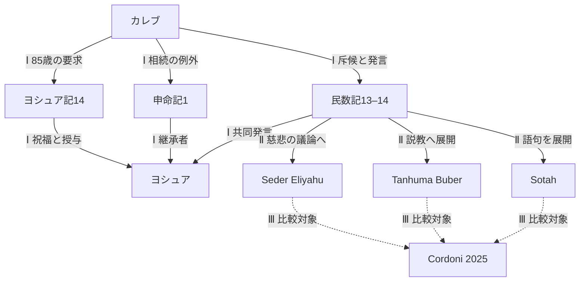
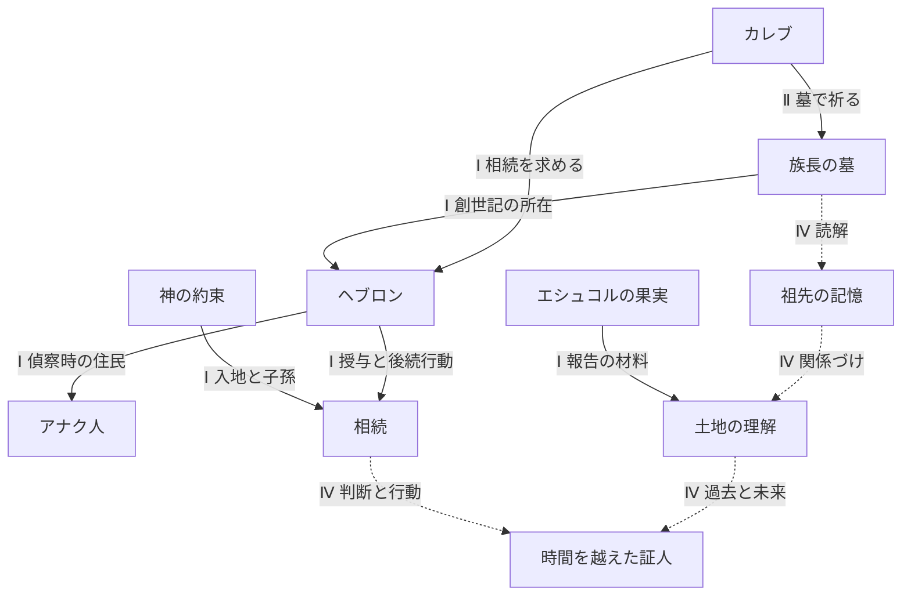
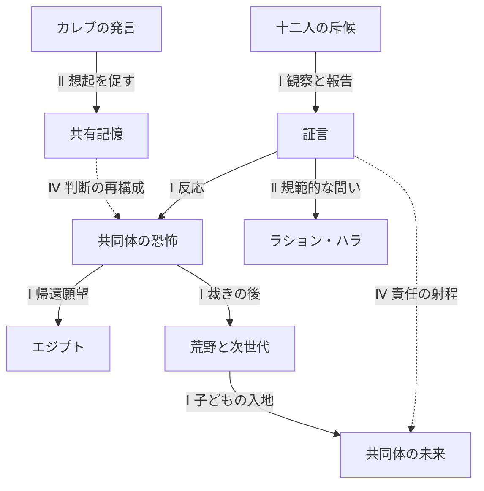

# Research Graph — 関係、出典、訂正の影響

[入口](README.md) / [出典](sources.md) / [根拠台帳](evidence.jsonl)

目次： [図](#views)・[ノード](#nodes)・[関係](#edges)・[命題の検証](#thesis)

このGraphは因果の実証図ではなく、出典を持つ読解関係の地図である。実線は記された関係、破線は比較・統合的な読みへの接続を示す。Ⅰ／Ⅱ／Ⅲ／Ⅳは[出典の層](sources.md)を表す。全体を一枚に詰めず、問いごとに三つの図へ分けた。完全な関係とページ対応は表で保持する。

## 1. 三つの読み口

## 2. ノードと本文の所有先

| ID | ノード | 主に読むページ |
|---|---|---|
| C | Caleb ben Jephunneh | [統合理解](README.md) |
| N | Numbers 13–14 | [斥候](twelve-spies.md) |
| D | Deuteronomy 1 | [Torah比較](caleb-in-torah.md) |
| J | Joshua 14 | [85歳](caleb-at-85.md) |
| Y | Joshua | [比較](caleb-and-joshua.md) |
| MO | Moses | [Torah比較](caleb-in-torah.md) |
| AR | Aaron | [斥候](twelve-spies.md) |
| SP | The twelve spies | [名簿](twelve-spies.md#twelve) |
| TEN | The ten negative spies | [報告](twelve-spies.md#report) |
| IS | Israelite community | [共同体](twelve-spies.md#future) |
| EG | Egypt | [Torah比較](caleb-in-torah.md) |
| WI | Wilderness | [共同体](twelve-spies.md#future) |
| PL | Promised Land | [ヘブロン](hebron-and-ancestral-memory.md) |
| H | Hebron | [ヘブロン](hebron-and-ancestral-memory.md) |
| A | Anakim | [斥候](twelve-spies.md#mission) |
| G | Grapes of Eshcol | [Sotah](talmud-sotah.md#grapes) |
| P | Patriarchal tombs | [墓](hebron-and-ancestral-memory.md#tombs) |
| M | Ancestral memory | [記憶](hebron-and-ancestral-memory.md#memory) |
| V | Divine promise | [85歳](caleb-at-85.md#voices) |
| DS | Different spirit | [評価](caleb-in-torah.md#spirit) |
| LH | Lashon ha-ra | [Tanhuma](tanhuma.md#mercy) |
| BT | Babylonian Talmud | [比較](rabbinic-readings.md) |
| SO | Sotah | [Sotah](talmud-sotah.md) |
| TA | Tanhuma | [版を限定した研究](tanhuma.md) |
| SE | Seder Eliyahu | [慈悲と証言](seder-eliyahu.md) |
| CO | Constanza Cordoni | [研究](constanza-cordoni-2025.md) |
| RR | Rabbinic reception | [比較](rabbinic-readings.md) |
| LE | Leadership | [比較](caleb-and-joshua.md) |
| RH | Rhetoric / Public speech | [発言](talmud-sotah.md#speech) |
| CR | Crowd psychology / Crowd | [報告と反応](twelve-spies.md#report) |
| TE | Testimony | [証言倫理](seder-eliyahu.md#ethics) |
| FU | Community future | [共同体](twelve-spies.md#future) |
| IN | Later inheritance | [85歳](caleb-at-85.md#action) |
| SI | Biblical silence / textual gaps | [比較](rabbinic-readings.md#method) |

## 3. 必須の関係と根拠

| 関係 | 層・根拠 | 関係の意味と限界 |
|---|---|---|
| C ↔ N・D・J | Ⅰ B1–B3 | 同一人物を語る三つの物語配置 |
| C ↔ Y | Ⅰ B1–B4 | 共同発言、共有された記憶、祝福と授与。優劣の線ではない |
| C ↔ H | Ⅰ B1・B3・B4 | 偵察の場と後の相続。単独墓参はR1が加える |
| H ↔ P | Ⅰ B6 | 創世記の埋葬の場所 |
| P ↔ M | Ⅱ R1、Ⅳ | 執り成しを求める場から祖先の記憶という理解へ |
| M ↔ PL | Ⅱ R2 §3・16、Ⅳ | 祖先への約束と地名を通じた接続 |
| C ↔ RH | Ⅰ B1、Ⅱ R1・R2 | 本文の発言を、再話が戦略・想起へ展開 |
| C ↔ CR | Ⅰ B1、Ⅱ R1・R2 | 民を静めるが反論・脅威は残る |
| C ↔ MO | Ⅰ B1・B3 | 派遣者への報告、回想される誓い |
| MO ↔ SP | Ⅰ B1・B2、Ⅱ R1–R3 | 派遣責任。命令・提案・裁量を出典ごとに区別 |
| MO ↔ AR | Ⅰ B1、Ⅱ R2 | 共にひれ伏す。無力さの強調は再話の評価 |
| SP ↔ TEN | Ⅰ B1 | 十二人の中で二人と十人が結末で分かれる |
| SP ↔ TE | Ⅰ B1・B2 | 観察から報告へ。報告を全て事実と同定しない |
| TE ↔ FU | Ⅰ B1、Ⅱ R3、Ⅳ | 反応・裁き・次世代への影響と責任の読み |
| SP ↔ LH | Ⅱ R1・R2 | 土地への中傷という評価。任意の否定的報告一般を禁止しない |
| G ↔ PL | Ⅰ B1、Ⅱ R1・R2 | 豊かさの材料。同じ果実の使い方は伝承で異なる |
| PL ↔ V | Ⅰ B1–B3、Ⅱ R2 §3 | 与える土地と祖先の約束 |
| C ↔ IN | Ⅰ B3・B4 | 要求、授与、後続行動を区別して結ぶ |
| C ↔ DS | Ⅰ B1 | 民14:24の評価。現代の人格診断ではない |
| IS ↔ EG | Ⅰ B1・B2 | エジプトへの帰還願望と、救いの回想 |
| IS ↔ WI ↔ FU | Ⅰ B1 | 荒野の世代交代と子どもの入地 |
| H ↔ A | Ⅰ B1・B3・B4 | 同じ危険の場所へ後年再び向かう |
| BT ↔ SO | Ⅱ R1 | 文献の所属関係。独立した二つの証拠ではない |
| RR ↔ SO・TA・SE | Ⅱ R1–R3 | 異なる場・文献形式での再話 |
| RR ↔ SI | Ⅱ R1–R3 | 語形・沈黙・語りの差を展開する |
| CO ↔ RR | Ⅲ M1 | 比較受容史の研究。古代の話者ではない |
| C・Y ↔ LE | Ⅰ B1–B4、Ⅳ | 異なる役割を比較する分析概念 |
| RH ↔ CR ↔ TE | Ⅱ R1–R3、Ⅳ | 発言の入口、聴衆、真実性を共に考える。実験心理学の因果証明ではない |

## 4. 統合命題を検証する

「カレブは土地の現実、祖先の記憶、神の約束、共同体の恐怖を同時に読み、別の未来を語った」という命題は、**複数文献を層別に結ぶ解釈として支持できる**。

| 要素 | 根拠 | 判定 |
|---|---|---|
| 危険と豊かさを判断に含む | 民13–14、ヨシュ14:12 | 本文に足場あり。恐怖を感じなかったとは言えない |
| 神の約束を保持する | 民14:7–9、ヨシュ14:6–12 | 本文の発言と回想に足場あり |
| 祖先の記憶と土地をつなぐ | 創23・49＋Sotah34b、TanB§3・16 | 伝承を含む統合。民数記単独の内面描写ではない |
| 群衆へ別の判断を語る | 民13:30、14:7–9、Sotah35a | 支持。全員の説得成功は支持しない |
| 後年の行動で言葉を引き受ける | ヨシュ14–15、士1 | 文学的な接続として支持。単一の史実年表は未確定 |

墓参伝承が訂正された場合、祖先の記憶に関するカレブ個人の説明は再検討するが、本文の八十五歳や相続まで消さない。Seder Eliyahuの章対応が訂正された場合は、証言倫理の出典とリンクを見直し、民数記の名簿は影響させない。この分離を[根拠台帳](evidence.jsonl)の `claims.ref`・`relation`・`scope`・`limits`で保持する。
